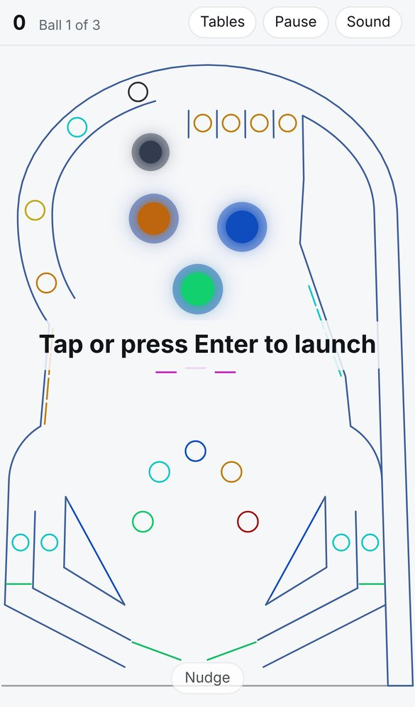
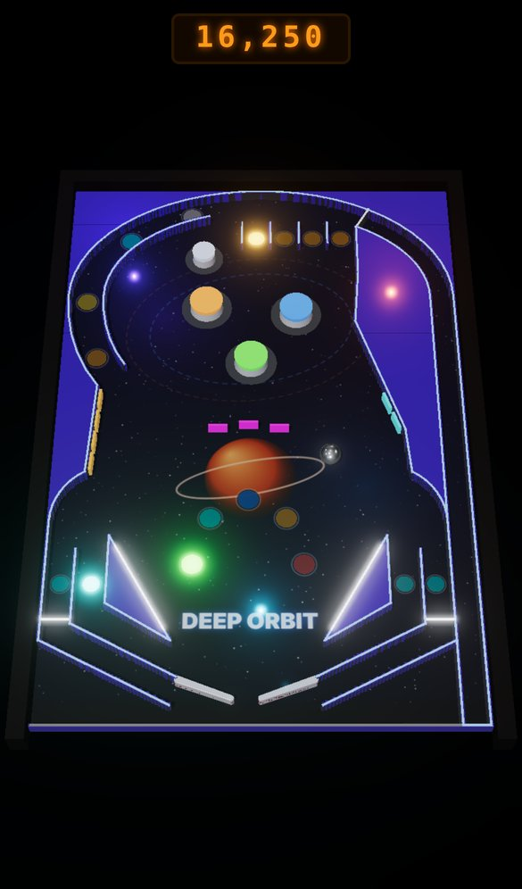
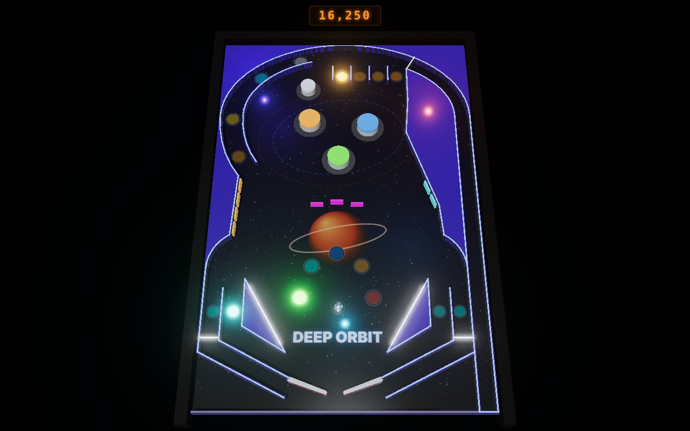

# 3D upgrade spec

Status: draft, red-teamed once, waiting for the owner's approval. Nothing gets built until it's
approved. The v1 plan is in [SPEC.md](SPEC.md); everything there still holds unless this page
changes it.

## Why

The v1 table is drawn as thin lines on a flat canvas. It's sharp, but it looks like a diagram,
not a pinball machine. The owner wants the look of a modern 3D pinball video game: a real table in
perspective, raised plastics, lit inserts that glow, a chrome ball that reflects the room, solid
bumpers and flippers, and painted playfield art.

A throwaway prototype (Deep Orbit drawn with three.js on top of the existing engine, not part of
this repo) showed the approach works with the real physics unchanged. It was rendered with
software WebGL and has none of the build's polish (smooth plastic edges, halos, tuned camera), so
read it as a floor for the look, and as roughly how far art drawn in code goes.

| v1 today | 3D prototype, phone | 3D prototype, desktop |
| --- | --- | --- |
|  |  |  |

## Decisions

| # | Question | Answer (defaults until the owner says otherwise) |
| --- | --- | --- |
| 1 | What changes | Only how the table is drawn. Physics, table files, rules, controls, sound, scores and the table checker stay as they are |
| 2 | Renderer | [three.js](https://github.com/mrdoob/three.js) (MIT) with its WebGL 2 renderer, vendored at an exact version. No build step |
| 3 | Physics | The existing 2D Box2D core (planck.js). Heights are drawn, not simulated |
| 4 | Camera | One fixed "cabinet" camera that shows the whole table, looking down it from the player's end. A camera that follows the ball comes later if wanted |
| 5 | Light and dark | The 3D table always sits in a dark room so its lights read. The page around it (header, buttons, dialogs) still follows the site theme. This changes v1 decision 2 for the 3D view only |
| 6 | Flat view | The v1 line drawing stays as the Flat view: a Graphics setting, and the fallback when 3D can't run |
| 7 | Playfield art | Drawn in code per table by Claude, at high resolution. No image files, no generated images |
| 8 | Flippers | Drawn to match their physics shape (a 0.24-wide bar), so the ball never sinks into them. They look slimmer than real flippers. Fatter flippers would mean changing the physics and retuning all four tables |
| 9 | Ramps and spinners | Not in this upgrade. They come with tables 6-9, now in 3D (see "Later") |

## Prior art

| Source | License | What we use |
| --- | --- | --- |
| [three.js](https://github.com/mrdoob/three.js) r187 (`three@0.187.0`, October 2026) | MIT | The renderer, plus add-ons: `RoomEnvironment`, and on the High tier `EffectComposer`, `RenderPass`, `UnrealBloomPass`, `OutputPass` with the passes and shaders they import. The package's one `LICENSE` covers the add-ons |
| [vpx-js](https://github.com/vpdb/vpx-js) | GPL-2.0 | Not used. A port of Visual Pinball that also draws with three.js, but it needs Visual Pinball table files and its own physics. It confirms three.js can carry a full 3D table in a browser |
| [Neon Gutter](https://github.com/red-reddington/web-demos/tree/main/neon-gutter) | not stated | Not used, looked at only: a single-file three.js pinball with hand-written physics |
| [I/O Pinball](https://github.com/flutter/pinball) | MIT | Already credited in v1 for ideas; nothing new taken |

Commercial 3D pinball games set the bar for the look. We take nothing from them: no names,
tables, art, sounds, fonts or score-display art.

## How it works

### The split

The engine (`Field`, elements, planck) already keeps all game state: positions, angles, which
targets are down, which walls are retracted or hidden, which lights are lit and every element's
current color. v1's `CanvasRenderer` reads it through each element's `draw()` calls. The 3D view
reads the same state directly instead:

- **Build** once per table: each element becomes a three.js object (a "part"), placed from the
  element's own geometry. Changing tables disposes every geometry, material and texture of the
  old one, since iOS kills tabs that leak GPU memory.
- **Bind** once per game: `newGame()` creates a new `Field`, so parts are re-pointed at the new
  field's elements by index. Nothing is rebuilt.
- **Sync** every frame: each part copies what changed (flipper angle, ball position, bumper
  position and flash, drop target up or down, rollover lit, wall retracted or hidden, color).

Elements don't change, and no game code imports three.js. Field units map to world units 1:1:
`x = fx - width/2`, `z = height/2 - fy`, and `y` points up off the playfield. The table itself
lies flat; the camera angle gives the cabinet look.

### What the ball can touch decides what's raised

Every solid above the playfield matches its physics footprint within 0.05 units, so the ball never
looks like it passes through something. Anything wider is a flat decal on the playfield.

| Element | Part |
| --- | --- |
| Areas the ball can never reach | **Raised plastic.** At load, the fixed walls are drawn into a grid, filled from the launch position, and every cell the ball can't reach is raised 0.6 as glossy colored plastic: slingshot islands, lane guides, the body outside the outer walls. Walls that can open (retracting, hidden or `ignoreBall`) count as open for this fill. Edges are traced into smooth outlines, not grid steps. This is what makes the table read as a machine instead of lines (compare the two prototype rounds) |
| `WallElement`, `WallPathElement`, `WallArcElement` | A metal rail along the wall with a lit top edge in the element's color. Walls with `kick` (slingshots) are white rubber that lights up when hit. All rails are one instanced mesh (tables have 108 to 220 pieces); sync shrinks a piece to nothing when its wall is retracted or hidden and updates its color. `ignoreBall` walls are drawn flat |
| `BumperElement` | A pop bumper at the collider's radius: white body, cap in the element's color that flares when hit. The outer ring (`outerRadius`) is a flat chrome decal. Follows its position every frame (Round and Round moves its bumpers) |
| `FlipperElement` | A paddle the shape of the physics bar (white plastic, colored rubber edge), turned to the joint's angle |
| `DropTargetGroupElement` | Upright colored targets that sink into the playfield when knocked down and rise when reset |
| `RolloverGroupElement` | Inserts under the playfield's clear coat, dim when off and glowing when lit. Hidden when the group is hidden |
| `SensorElement` | Nothing drawn, as in v1 |
| Ball | A polished steel sphere that reflects the room (its own reflection strength, so it doesn't go dark), with a real shadow |
| Table | Clear-coated playfield with the table's art, wooden side rails, an apron |

A node test fails if any element type used by a listed table has no part, so a future element
type can't ship without one.

Element colors go through the existing theme mapping (`Palette`) with its dark-theme values, so
tables keep the site's blue and green hues. `Palette.css()` returns `hsla()` text; the 3D view
reads the same numbers into a three.js color, plus opacity where the alpha is below 1.

### Messages and score pop-ups

v1 draws `field.message` ("Tap or press Enter to launch", ball saved, tilt, mission names) and the
floating score pop-ups on the canvas. In 3D the message is an HTML overlay in the same place, and
each pop-up is an HTML label placed over its spot on the table. The existing HUD score
(`#score`, already read by screen readers) is restyled as an original dot-matrix style panel.

### Playfield art

Each table may have `tables/<id>.art.js`, a module that paints its playfield into a 2D canvas in
field units (gradients, shapes, text, lane arrows). The 3D view turns it into a texture and then
frees the canvas. Colored light pools and soft contact shadows around walls and bumpers are
painted into the art too, which looks like extra lights for free. Without an art file, a default
painter draws a dark gradient, an insert ring under every rollover, and the table's name.

The table JSON stays in the unchanged Vector Pinball format; the art file sits beside it, like
the rules file. All art is original and matches each table's theme (Deep Orbit gets space, and
Ringmaster a circus tent).

### Camera

Fixed, looking down the table from the player's end, pulled back until the whole table fits.
Phones in portrait are width-limited, so their camera sits lower and closer so the table fills
the height. The exact angles are tuned on screenshots in the first pull request. The nudge shake
is off under `prefers-reduced-motion`.

### Canvas and input

The 3D view draws on a second canvas in the same game area; the Flat canvas is hidden, not
reused, since a canvas can't hold both a 2D and a WebGL context. The touch, keyboard and resize
handlers move from the canvas to the game area, so they work for both views.

### Light and glow

- Image-based lighting from three.js's procedural `RoomEnvironment` (no image download) and one
  directional light. Only the ball casts a real shadow; everything else's shadow is painted into
  the art or comes from the plastics.
- Glow comes from soft additive halo sprites behind lit inserts, bumper caps and lit rail edges.
  They're cheap, so both tiers glow. High adds a bloom pass on top.
- Antialiasing: High renders into a 4-sample target (three.js's post-processing targets have none
  by default, which left the prototype's rails jagged). Low draws straight to the screen with the
  browser's antialiasing and no post-processing.

### Flash safety

The same rule as the other games: no full-screen flashes, nothing flashes more than 3 times a
second, and a flash covers one element. A bumper hit sets `flashMs` for 100 ms, and a ball rattling
between bumpers can hit far more often than 3 times a second, so every part's flare goes through
one limiter: a part's light can rise at most once per 333 ms, easing up and down instead of
blinking. It's a small pure function with a node test. `prefers-reduced-motion` turns flares and
pulses into plain on/off changes.

### Quality and performance

Target: a steady 60 frames a second on a three-year-old mid-range phone (iPhone 12 or Pixel 6a
class) on High, and a playable game on older phones on Low. Physics stays at 120 steps a second
in game time, whatever the frame rate.

| Tier | Pixel ratio cap | Playfield texture | Post-processing |
| --- | --- | --- | --- |
| High | 2 | 2048 × 3072 | 4-sample target and bloom |
| Low | 1.25 | 1024 × 1536 | none |

- Shaders compile before play starts (`compileAsync`), so the first seconds don't stutter.
- **Auto** (default) starts on High. After the first 5 seconds of play, if the median frame takes
  longer than 20 ms over 3 seconds, it switches to Low at the next ball, never mid-ball. If Low
  still takes longer than 40 ms, it switches to Flat at the next ball, with a message saying how
  to switch back. An iPhone in Low Power Mode (capped at 30 frames a second) will drop to Low;
  that's accepted.
- The Graphics setting offers Auto, High, Low and Flat, saved on the device. `?gfx=high|low|flat`
  overrides it for testing, and `?fps=1` shows a frame-time readout for checking on a real phone.
- Budgets checked by reading the code, not measured: under 100 draw calls; at most these
  textures at once: the playfield, one environment map, one shadow map (1024 for the ball) and,
  on High, the render target and bloom chain.
- The render loop stops while the game is paused or the tab is hidden.

### Loading, offline and fallback

- three.js loads with a dynamic `import()` only when the 3D view is chosen, so the Flat view and
  the menus never wait for it.
- The 3D files are 2.19 MB uncompressed (about 440 KB compressed over the network). `sw.js`
  precaches them like every other game file, including for players who only use Flat, so the
  installed app plays offline in either view. As today, each release downloads every file again.
- The game falls back to Flat, with a short message, when WebGL 2 isn't available, the 3D module
  fails to load, or the WebGL context is lost and can't be restored.

### Vendoring three.js

- `tools/vendor-three.mjs` downloads `three@0.187.0` from the npm registry, checks the package's
  published integrity hash, copies only the files listed in the tool into `vendor/three/`, and
  rewrites their `from 'three'` imports to relative paths. Import maps would also work but need
  Safari 16.4, while WebGL 2 only needs 15. Upgrading three.js means changing one version line
  and running the tool.
- The files are kept unminified (three.js stopped shipping minified builds in r186); Cloudflare
  compresses them.
- `vendor/three/LICENSE` keeps the MIT notice. The README and the About screen credit three.js
  next to planck.js.

### Files

```
src/three/view.js       renderer, camera, tiers, fallback, build/bind/sync, dispose
src/three/parts/*.js    one file per part (plastics, rails, bumper, flipper, targets, inserts, ball, cabinet)
src/three/glow.js       halo sprites and the flash limiter
src/three/art.js        default playfield painter and the art-file loader
tables/<id>.art.js      optional playfield art per table
vendor/three/           three.js r187 and the listed add-ons, MIT
tools/vendor-three.mjs  fetches and checks the vendored files
tools/check-3d.mjs      browser check (Playwright), see below
```

`src/main.js` picks the view and keeps everything else it does today.

### Checks

- `node --test` adds: field-to-world mapping, every part matches its physics footprint within
  0.05, every element type in the listed tables has a part, the flash limiter, the plastics fill
  (a known table gives the expected raised areas), and that `sw.js` lists the vendored files.
- `node tools/check-table.mjs` is unchanged.
- `node tools/check-3d.mjs` (Playwright with software WebGL, `?gfx=high` and `?gfx=low`) loads
  every table in 3D, launches a ball, plays a few seconds with scripted flips, and fails on any
  console error, a blank frame, or a fallback to Flat. It saves phone and desktop screenshots for
  the pull request. It runs locally before each pull request, not in CI, because the repo has no
  `package.json` and Playwright isn't pinned (the same as `tools/make-icons.mjs` today).

## Pull requests

Two, with a look check in between:

1. **3D on one table, opt-in:** vendored three.js and its tool, every part, plastics, glow, both
   tiers, the Graphics setting, fallback, Deep Orbit's art, the restyled score, offline files and
   checks. Flat stays the default; `?gfx=high` (or the Graphics setting) turns 3D on. **The owner
   plays it on his phone and says whether the look is right before anything else is built.**
2. **Roll out:** art for Classic, Round and Round and Ringmaster, 3D (Auto) becomes the default, and
   README and About credits. Going back to Flat as the default is a one-line change.

**Done means:** all four tables play in 3D on a phone and a desktop at the targets above, the
owner has approved the look on his phone, Flat still works, the installed app plays offline in
both views, and every check above passes.

## Not in this upgrade

Ramps and spinners, tables 6-9, a follow camera, a 3D physics engine, WebGPU, music, phone
vibration, playfield toys (moving models), and image or AI-generated art.

## Later

- Ramps: Vector Pinball's `layer` key becomes a raised ramp, drawn at its height, with the ball
  lifted onto it when its layer changes. Physics stays 2D, as upstream does.
- A camera that follows the ball, if the fixed one feels too far away on phones.
- WebGPU: three.js's `WebGPURenderer` falls back to WebGL by itself, but it's larger and newer;
  revisit once the WebGL version is settled.

## Open questions for the owner

Each has a default that stands if the answer is "defaults".

1. Flippers: slimmer flippers that match today's physics, or realistic fat flippers with the
   physics changed and all four tables retuned? Default: **slim, physics unchanged**.
2. The 3D table always in a dark room, even when the site is in light mode? Default: **yes**.
3. Art drawn in code by Claude (the prototype shows roughly how far that goes), rather than
   generated images? Default: **drawn in code**.
4. Keep Flat as a choice in Graphics, not only a fallback? Default: **yes**.
5. Ramps after this upgrade, with tables 6-9? Default: **yes, later**.
